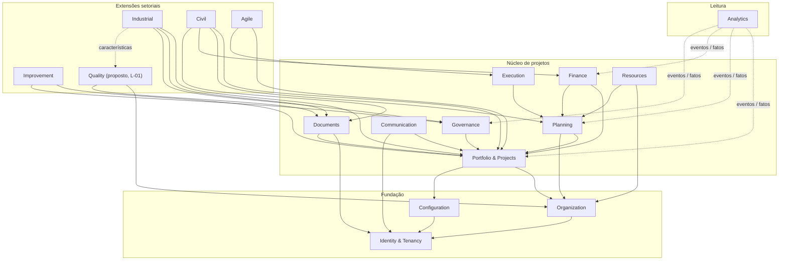

# Mapa de contextos delimitados

**Status:** proposta para validação. Baseado no §3 da especificação, com os ajustes identificados na Fase 0.

## 1. Diagrama de contextos

Setas cheias indicam **dependência por contrato público** (interface de serviço ou leitura publicada). Setas pontilhadas indicam **consumo de eventos**. Nenhuma seta significa acesso a tabelas de outro contexto.

## 2. Responsabilidades e ajustes

| Contexto | Responsabilidade (§3) | Ajuste proposto na Fase 0 | Evidência / hipótese / pendência |
|---|---|---|---|
| Identity & Tenancy | Empresas, plantas, usuários, autenticação, RBAC/ABAC | **Plantas e unidades** (`organization_unit`) ficam aqui, como no §4 | **Evidência:** o §4 coloca `organization_unit` sob `tenant`. **Pendência:** confirmar (C-07) |
| Organization | Clientes, fornecedores, equipes, calendários | Separar **parte externa** (`client`, `supplier`) de **unidade interna**. "Cliente interno" vira `organization_unit` mais um papel de demandante | **Evidência:** `projetos/js/sample.js` usa clientes internos. **Hipótese:** o usuário quer agrupar projetos internos por área |
| Portfolio & Projects | Programas, portfólios, projetos, termo de abertura, status | Incluir **indicadores de valor** (linha de base → meta) do termo | **Evidência:** `indicadores` em `projetos/js/projeto.js` (aba Termo) |
| Planning | EAP, atividades, dependências, calendário, Gantt, CPM, baseline | — | Ausente hoje (L-05, L-06) |
| Execution | Apontamentos, Kanban, impedimentos, evidências | O status operacional da atividade fica aqui. Datas planejadas ficam em Planning | **Evidência:** hoje status e datas ficam no mesmo objeto `tarefa` |
| Finance | Orçamentos, custos, compromissos, EVM | EVM com **método de medição** por atividade ou pacote | L-07 |
| Resources | Competências, capacidade, alocação | Pessoa = `user` ou `resource` por **ID**, nunca por nome | L-03 |
| Governance | Riscos, questões, mudanças, decisões, aprovações | **Gates** (go/no-go) entram como aprovação tipada | **Evidência:** `marcos` com `STATUS_GATE` (`projetos/js/projeto.js:30`) |
| Documents | Metadados, versões, arquivos, assinaturas, acesso | — | Ausente (L-11) |
| Communication | Reuniões, atas, ações, notificações | O relatório de status vira um **artefato gerado** | **Evidência:** `statusReport` em `projetos/js/projeto.js` |
| Configuration | Templates, versões, workflows, campos e regras | Tailoring como passo do assistente de instanciação | **Evidência:** `projetos/js/calc.js:173` |
| Analytics | Projeções e KPIs a partir de eventos e fatos | Saúde por **domínio PMBOK 8** como projeção padrão | **Evidência:** `projetos/js/calc.js:192`. **Pendência:** P-10 |
| Industrial | APQP, PPAP, FMEA, planos de controle, try-out | Não cria características; **referencia** as características do contexto Quality | L-01 |
| Civil | Empreendimentos, locais, orçamento de obra, diário, medição | — | Ausente (L-12) |
| Agile | Backlog, sprints, métricas Scrum | Mover sprints e pontos do núcleo para cá | L-16 |
| Improvement | DMAIC, PDCA, ações e ganhos | Ganhos ligados aos indicadores de valor do projeto | **Evidência:** modelo DMAIC em `projetos/js/pmbok.js:98` |
| **Quality** (novo, proposto) | Inspeção, NC/8D, calibração, MSA, SPC, plano de controle e características | **Decisão pendente:** criar o contexto, integrar o app A ou deixá-lo fora do produto | L-01 / P-02 |

## 3. Relações entre contextos (padrões DDD)

| A montante (upstream) | A jusante (downstream) | Padrão | Observação |
|---|---|---|---|
| Identity & Tenancy | todos | Open Host Service | Fornece `tenant_id`, ator e permissões. Todos se conformam |
| Organization | Projects, Resources, Quality | Published Language | Leitura de cliente, fornecedor, calendário e equipe por ID |
| Configuration | Projects | Customer/Supplier | O projeto recebe um **snapshot** da versão do template (§5) |
| Projects | Planning, Finance, Governance, Documents, extensões | Open Host Service | A extensão setorial guarda um *profile* 1:1 com o projeto (§4) |
| Planning | Execution, Finance, Resources, Civil | Published Language | Atividades e baseline publicadas. A extensão não grava em Planning diretamente; usa comandos |
| Todos | Analytics | Eventos (outbox) | Somente leitura, por consumo idempotente |
| Quality | Industrial | Anticorruption Layer | A extensão industrial referencia características e revisões sem conhecer o esquema de Quality |
| Sistemas externos (ERP, e-mail, armazenamento) | Finance, Communication, Documents | Anticorruption Layer | Pendente (P-07) |

## 4. Eventos de domínio

**Formato:** `{ event_id (UUIDv7), event_type, event_version, tenant_id, aggregate_type, aggregate_id, aggregate_version, occurred_at (UTC), actor_id, correlation_id, causation_id, payload }`.

**Entrega:** *transactional outbox*, com consumo idempotente por `(consumer, event_id)`.

| Evento (§3) | Publicador | Consumidores previstos | Observação |
|---|---|---|---|
| `ProjectCreated` v1 | Projects | Analytics, Communication, extensões | Leva `template_version_id` |
| `BaselineApproved` v1 | Planning | Finance (VP), Analytics, Communication | Leva `baseline_id` e `version` |
| `TaskRescheduled` v1 | Planning | Resources, Analytics, Civil | **Nome inconsistente:** a entidade é `activity`. Proposta: `ActivityRescheduled` (C-05) |
| `BudgetRevisionApproved` v1 | Finance | Analytics, Communication | — |
| `ChangeApproved` v1 | Governance | Planning, Finance, Projects | Gatilho para nova revisão (CA-4) |
| `DocumentRevisionReleased` v1 | Documents | Industrial, Civil, Communication | — |
| `MeasurementApproved` v1 | **Civil** | Finance, Analytics | Evento de extensão, não do núcleo. Proposta: `civil.MeasurementApproved` (C-06) |

**Eventos sugeridos, ausentes na especificação** (validar):

- `ProjectStatusChanged`
- `ActivityProgressReported`
- `CostTransactionRecorded`
- `RiskAssessed`
- `ApprovalRequested` e `ApprovalDecided`
- `TemplateVersionPublished`
- `MembershipChanged`, para invalidar permissões em cache
