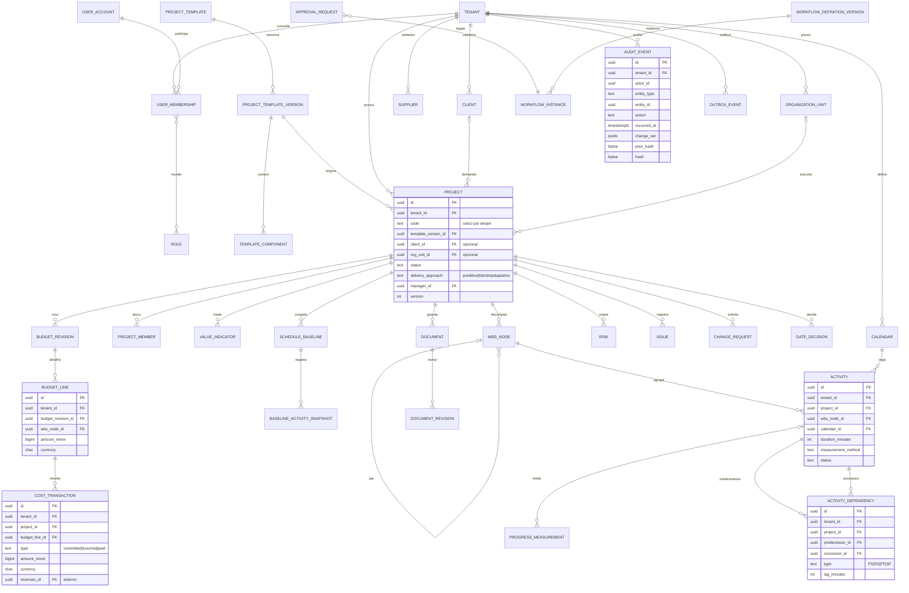
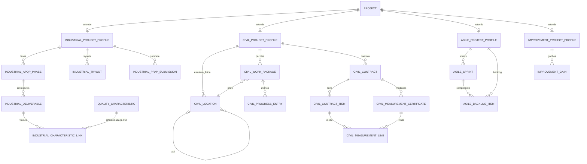

# Modelo de dados conceitual

**Status:** proposta conceitual. **Nenhuma tabela foi criada.** As migrações só começam na F1, após aprovação.

## 1. Convenções propostas

| Tema | Proposta | Evidência / hipótese / pendência |
|---|---|---|
| Identificadores | `uuid` **v7** gerado no servidor (ordenável no tempo). Código legível (`PRJ-2026-001`) é campo separado, **único por tenant** | **Evidência:** hoje os IDs são `Date.now` + aleatório gerados no navegador (`projetos/js/pmbok.js:149`). **Pendência:** confirmar o formato dos códigos legíveis por entidade |
| Tenant | Coluna `tenant_id NOT NULL` em **toda** tabela com dados de cliente, inclusive filhas (atividade, linha de orçamento, revisão) | Regra §4 (FKs compostas). Ver C-01 |
| Chaves estrangeiras | Compostas `(tenant_id, x_id)` para impedir referência cruzada entre tenants | Regra §4 |
| RLS | `ENABLE ROW LEVEL SECURITY` + política `tenant_id = current_setting('app.tenant_id')::uuid` em todas as tabelas de tenant; papel da aplicação **sem** `BYPASSRLS` | §9. RLS não substitui a autorização na aplicação |
| Esquema por contexto | Um *schema* PostgreSQL por contexto (`identity`, `org`, `project`, `planning`, `finance`, `governance`, `docs`, `config`, `analytics`, `ext_industrial`, `ext_civil`, `ext_agile`, `ext_improvement`) | **Hipótese:** facilita impedir acesso cruzado com `GRANT` por módulo. **Pendência:** ADR futura |
| Instantes | `timestamptz` em UTC. Fuso de exibição no perfil do usuário ou da planta | §4 |
| Datas de calendário | `date` (início e término planejados de atividade) | **Evidência:** hoje são texto `AAAA-MM-DD` (`projetos/js/calc.js:18`) |
| Durações e defasagens | Em **minutos de tempo útil**, segundo o calendário da atividade (`lag_minutes`, §4) | **Pendência:** P-05 (calendário, turnos e feriados) |
| Dinheiro | `amount_minor bigint` + `currency char(3)` (ISO 4217). **Nunca** `float` | **Evidência:** hoje usa `float` (`projetos/js/calc.js:28`). §4 |
| Percentuais | `numeric(7,4)` ou pontos-base em inteiro | — |
| Estados | Campos `status` com `CHECK` ou tipo enum, e transições validadas no domínio (`domain-rules.md`) | — |
| Concorrência | `version int` por agregado (bloqueio otimista); o evento leva `aggregate_version` | — |
| Exclusão | Lógica (`deleted_at`) **só** para cadastros. Revisões aprovadas, baselines, transações e auditoria **não** são excluíveis | §2.4, §4 |
| Auditoria | `audit_event` só de inserção (*append-only*): `REVOKE UPDATE, DELETE`, com encadeamento de hash | Ver C-08 |
| Idempotência | Tabela `idempotency_key(tenant_id, key, request_hash, response, expires_at)` | §9 |

## 2. ERD conceitual — núcleo

## 3. ERD conceitual — extensões setoriais

As extensões só se ligam ao núcleo por `project_id` (*profile* 1:1, §4) e por IDs publicados (atividade, pacote de trabalho, documento). **Nunca** por FK para tabelas privadas de outro contexto. As FKs de extensão apontam para tabelas **públicas** de referência do núcleo, a confirmar na ADR de módulos.

## 4. Correspondência com os dados atuais (para o importador)

| Documento atual (`projetos/js/store.js`) | Destino | Transformação |
|---|---|---|
| `clientes[]` com `tipo: 'externo'` | `org.client` | Direto |
| `clientes[]` com `tipo: 'interno'` | `identity.organization_unit` | **Muda de natureza** (C-07). Exige confirmação |
| `projetos[].codigo/nome/status/fase/abordagem` | `project.project` | `fase` → área de foco atual (campo derivado ou estado). `status` mapeado (ver `domain-rules.md`) |
| `projetos[].orcamento` (float) | `finance.budget_revision` v1 + 1 `budget_line` | Converter para centavos; moeda BRL. Revisão importada como `approved` com origem "importação" |
| `projetos[].tarefas[]` (`fase` texto) | `wbs_node` (1 por fase) + `activity` | Gerar a EAP de 2 níveis. Datas → `date`. **Não há dependências para importar** |
| `tarefas[].responsavel` (nome) | `project_member` / `user` | **Casamento por nome é ambíguo**: exige revisão manual |
| `tarefas[].progresso` | `progress_measurement` com método `percent_subjective` | Marcar explicitamente como subjetivo (L-07) |
| `tarefas[].custoReal` | `cost_transaction(type=incurred)` | Uma transação de saldo por atividade, com origem "importação" |
| `tarefas[].sprint`, `sprints[]` | `ext_agile` | Só se a extensão Agile estiver ativa |
| `marcos[]` | `governance.gate_decision` + marco no plano | Gates aprovados importados como decisões históricas |
| `riscos[]`, `mudancas[]`, `questoes[]`, `licoes[]` | `governance.*` / `communication.*` | `dono`/`responsavel` por nome → revisão manual |
| `raci{fase:{nome:papel}}` | `project_member_role` por `wbs_node` | Chave por nome → revisão manual |
| App A (Core Tools) | Contexto Quality / extensão Industrial | Depende de P-02 |

## 5. Validação de consistência da especificação

Verificação pedida no prompt operacional: IDs, tenants, estados, revisões e eventos.

| ID | Tipo | Achado | Proposta | Bloqueante? |
|---|---|---|---|---|
| C-01 | Tenant | O §4 lista `tenant_id` só em `project` e `document`, mas a regra exige FKs compostas com `tenant_id`. `wbs_node`, `activity`, `budget_line` etc. não o têm | `tenant_id` em toda tabela de tenant; FK `(tenant_id, parent_id)` | Não. Decisão técnica, a registrar em ADR |
| C-02 | Tenant | `project_template(id, sector)` não tem dono: global, do tenant ou ambos? | `owner_tenant_id NULL` = template do sistema (somente leitura para todos); preenchido = template do tenant. RLS: `owner_tenant_id IS NULL OR owner_tenant_id = current_tenant` | **Sim** (P-04) |
| C-03 | IDs / integridade | `activity_dependency` sem `project_id`/`tenant_id` não consegue garantir "mesmo projeto" por constraint | Adicionar `tenant_id` e `project_id`, com FKs compostas `(tenant_id, project_id, predecessor_id)`. Dependência entre projetos vira entidade própria (`interproject_dependency`) | Não |
| C-04 | Revisões | `schedule_baseline` e `budget_revision` têm `version`, mas falta unicidade e estado da baseline (só `approved_at`) | `UNIQUE(project_id, version)`; estados `draft → submitted → approved → superseded`; só uma `approved` vigente por projeto (índice parcial) | Não |
| C-05 | Eventos | `TaskRescheduled` usa "task", mas a entidade é `activity` | Renomear para `ActivityRescheduled` | Não |
| C-06 | Eventos | `MeasurementApproved` é da extensão civil, mas aparece na lista do núcleo | Prefixar o *namespace*: `civil.MeasurementApproved` | Não |
| C-07 | Modelo | `organization_unit` (planta) está em Identity, e Organization tem "clientes". O app atual usa **cliente interno** para áreas da fábrica | Projeto com `client_id` **opcional** e `org_unit_id` (executora/demandante interna). Projeto interno = sem cliente externo | **Sim** (P-03) |
| C-08 | Auditoria | `audit_event` só guarda `before_hash/after_hash`: não permite reconstruir o que mudou nem provar a cadeia | Guardar `change_set jsonb` (campos alterados, com mascaramento de sensíveis) + `prev_hash`/`hash` encadeados por tenant | Não |
| C-09 | Unidades | `lag_minutes` em minutos, mas não há unidade de duração nem regra de calendário | Durações e lags em minutos úteis do calendário da sucessora (padrão a validar) | **Sim** (P-05) |
| C-10 | Finanças | O §5 separa comprometido, incorrido, pago e **previsto**, mas `cost_transaction.type` não lista os tipos. "Previsto" não é transação | `type ∈ {committed, incurred, paid}`; previsão em `cost_forecast` versionada; estorno por `reverses_id` | Não |
| C-11 | Modelo | `document.project_id` obrigatório? Há documentos de cliente e fornecedor | `project_id` opcional + `owner_type/owner_id` publicado | Não |
| C-12 | Estados | Estados de `project` não foram definidos | Ver máquina de estados em `domain-rules.md` | Não |
| C-13 | Versões | Templates GEN-001, IND-001 e CIV-001 sem regra de numeração de versão | `code` + `version int` monotônico + `status (draft, published, retired)`; publicada é imutável | Não |
| C-14 | Identidade | `user_membership` indica usuário global com vínculo por tenant. Tabela de usuário **não** tem `tenant_id` | `user_account` fora do RLS de tenant, acessível só pelo módulo Identity; o resto usa `membership_id`/`actor_id` | Não |
| C-15 | Civil | A chave de duplicidade de medição cita "evento de execução", que não está definido | `UNIQUE(contract_item_id, period_start, period_end)` por certificado não cancelado + saldo acumulado ≤ contratado | **Sim** para F5 (P-11) |
| C-16 | Finanças | O EVM exige método de medição (§5), mas não há campo no modelo | `activity.measurement_method ∈ {0/100, 50/50, marcos ponderados, unidades concluídas, % físico medido, % subjetivo (não permitido para EVM oficial)}` | Não |
| C-17 | Extensões | O §5 proíbe acesso direto a tabelas privadas, mas o §4 coloca FKs das extensões em `project_id` | Permitido: FK para tabela **pública** de referência (`project.project` exposta por *view* ou tabela de identidade). Documentar na ADR de módulos | Não |
