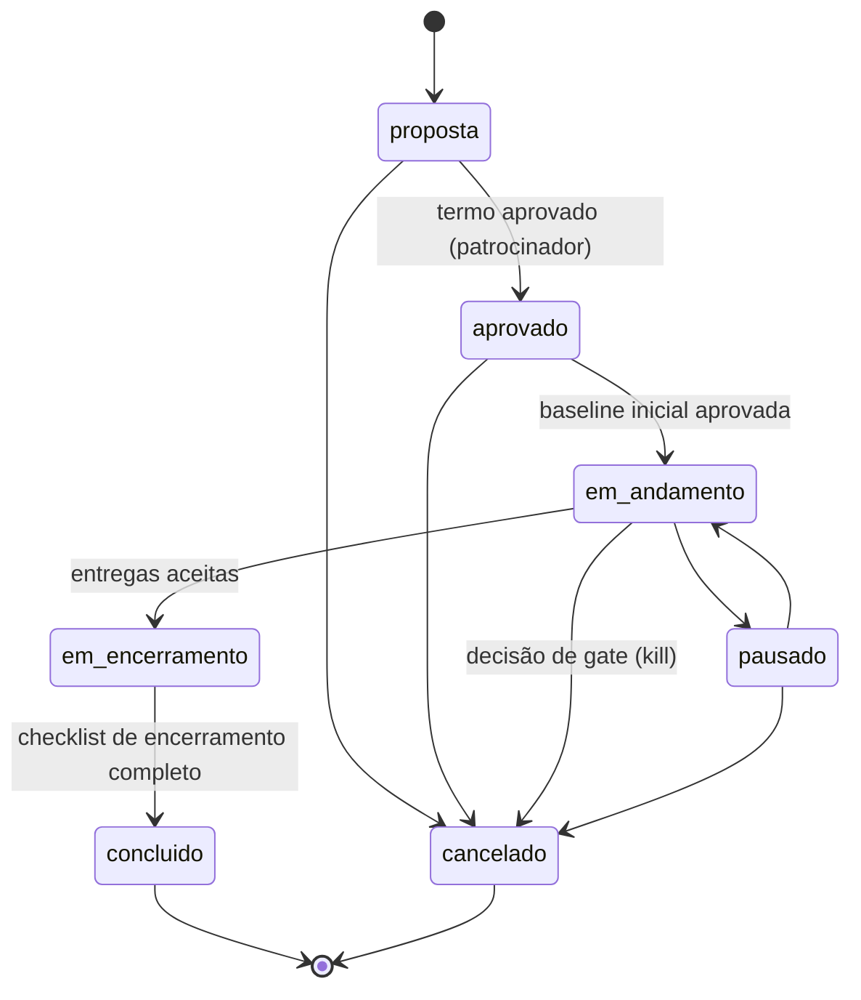
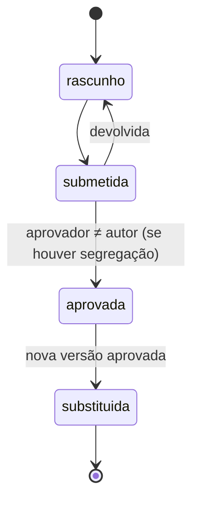
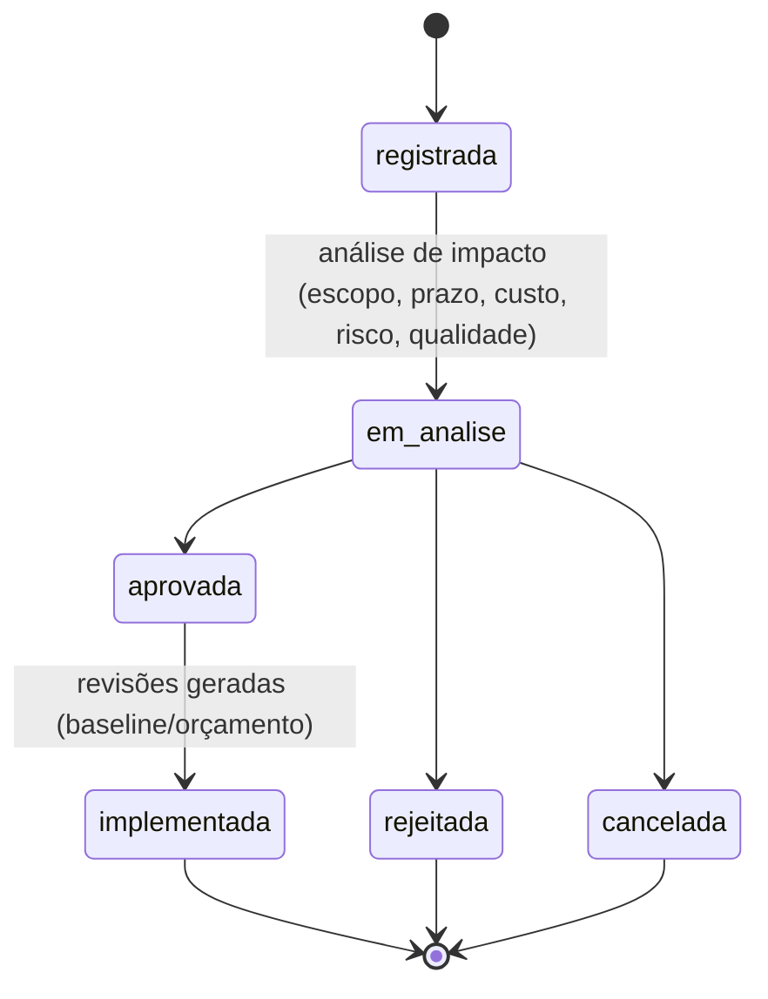
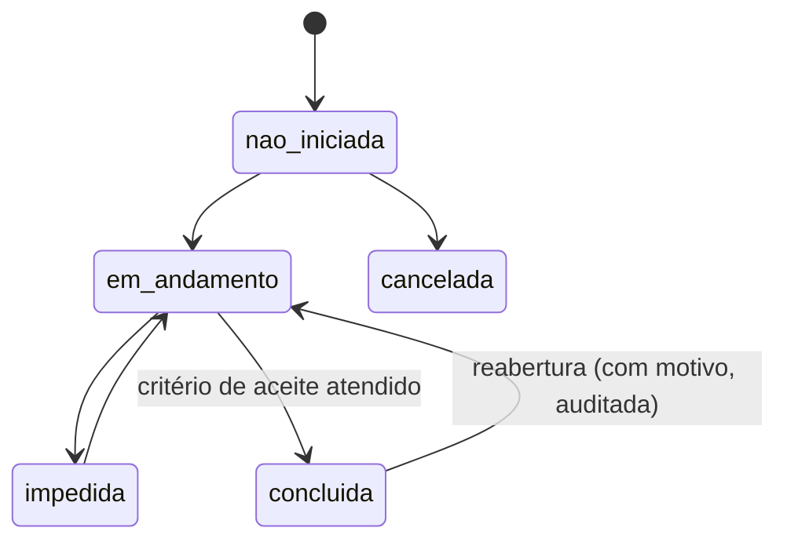

# Regras de domínio

**Status:** proposta. As regras vêm do §5 da especificação. A coluna "Situação atual" mostra o comportamento dos protótipos existentes.

## 1. Regras transversais

| ID | Regra | Origem | Situação atual (evidência) | Teste de aceitação |
|---|---|---|---|---|
| DR-01 | Todo dado de negócio pertence a um tenant. Leitura, escrita, exportação, anexo, cache, fila, busca e log filtram por `tenant_id` | §2.3 | ✗ Não há tenant | CA-1 |
| DR-02 | Projeto criado por template recebe um **snapshot** da versão escolhida, com `template_version_id` e mapeamento de IDs definição → instância. Nova versão do template **não** altera projetos existentes | §5, §6 | ✗ Modelo fixo no código, sem versão (`projetos/js/pmbok.js:155`) | CA-2 |
| DR-03 | A baseline aprovada é imutável. Só é substituída por **nova** baseline, com justificativa e autorização. A anterior fica `superseded` | §5 | ✗ Não há baseline | CA-3 |
| DR-04 | Reprogramar recalcula as sucessoras pelas dependências, pelo calendário e pelas restrições, e **não** reescreve valores aprovados da baseline | §5 | ✗ Datas editadas uma a uma, sem propagação | CA-3 |
| DR-05 | Alteração de escopo, custo ou prazo acima de limites configurados exige solicitação de mudança e aprovação **segregada** (quem solicita não aprova) | §5 | ◐ Mudança é só um registro (`projetos/js/projeto.js:31`) | CA-4, CA-7 |
| DR-06 | Mudança aprovada que afeta item controlado gera **nova revisão** (baseline e/ou orçamento) vinculada à mudança | §5 | ✗ | CA-4 |
| DR-07 | Custos comprometidos, incorridos, pagos e previstos são categorias distintas | §5 | ✗ Só "custo real" (`custoReal`) | — |
| DR-08 | O EVM oficial **não** usa % subjetivo. Exige método de medição definido por atividade ou pacote | §5 | ✗ Usa `progresso` subjetivo (`projetos/js/calc.js:72`) | CA-8 |
| DR-09 | Documento liberado não é editado no lugar: nova revisão + fluxo de aprovação. Todas as revisões ficam consultáveis | §5 | ✗ Não há documentos | CA-5 |
| DR-10 | Medição de obra valida o acumulado (≤ contratado + aditivos aprovados) e rejeita duplicidade por contrato, item e período. Correção por estorno ou revisão auditável | §5 | ✗ | CA-6 |
| DR-11 | Extensões não acessam tabelas privadas de outro contexto | §5 | n/a (sem banco) | Teste de arquitetura |
| DR-12 | Acesso externo (cliente/fornecedor) é negado por padrão e liberado por escopo de projeto, objeto e ação | §5 | ✗ | CA-1 |
| DR-13 | Ação sugerida por IA nunca aprova mudança, documento ou pagamento sozinha. Requer ator humano autorizado | §5 | n/a | Teste de autorização |
| DR-14 | Eventos de auditoria são *append-only* e correções geram eventos compensatórios | §2.4 | ✗ Exclusão física (`projetos/js/projeto.js:54`) | — |
| DR-15 | Configuração é declarativa, tipada e versionada. Não executa código arbitrário | §2.7 | ◐ Modelos são dados, mas fixos no código | — |
| DR-16 | Critérios normativos (AIAG, IATF, CSR, NR) vêm de fonte autorizada e parametrizada. O sistema **não** declara conformidade ou certificação | §2.8, §7 | ◐ O app A embute tabelas (p. ex. AP AIAG-VDA em `js/calc.js`) | — |
| DR-17 | Dados fictícios não existem em produção. Carga de exemplo só em ambientes de demonstração | CA-9 | ✗ Exemplos carregados no primeiro acesso (`projetos/js/app.js:599`) | CA-9 |
| DR-18 | Valores monetários exatos (inteiro em unidade menor). Arredondamento definido por regra e testado | §4 | ✗ `float` | CA-8 |

## 2. Máquinas de estado propostas

Os estados atuais vêm de `projetos/js/pmbok.js:67` e `projetos/js/projeto.js:30-31`. As transições abaixo são **propostas** (pendência P-08: validar com usuários).

### 2.1 Projeto

- **Atual:** `proposta`, `aprovado`, `andamento`, `pausado`, `concluido`, `cancelado`, com transição livre por um campo de seleção.
- **Proposta:** acrescentar `em_encerramento` e exigir as condições de guarda mostradas no diagrama.
- A "área de foco" do PMBOK 8 (`fase`) **não** é estado: é um atributo informativo.

### 2.2 Baseline de cronograma e revisão de orçamento

**Invariantes:**
- só uma versão `aprovada` vigente por projeto;
- `version` é monotônico;
- versão aprovada é imutável.

### 2.3 Solicitação de mudança

- **Atual:** `analise`, `aprovada`, `rejeitada`.
- **Proposta:** `aprovada` só leva a `implementada` quando as revisões geradas pela mudança estiverem aprovadas (DR-06).

### 2.4 Atividade (execução)

- **Atual:** `backlog`, `afazer`, `andamento`, `bloqueada`, `concluida`. Ao concluir, o avanço vira 100% automaticamente (`projetos/js/projeto.js:282`).
- **Proposta:** `backlog` passa a pertencer à extensão Agile.
- **Proposta:** as colunas do Kanban são uma **visualização** dos estados, não estados extras.

### 2.5 Revisão de documento

`em_elaboracao → em_revisao → aprovada → liberada → obsoleta`

- Só `em_elaboracao` aceita edição.
- `liberada` bloqueia edição (DR-09).
- Nova revisão começa em `em_elaboracao`.

### 2.6 Risco

`identificado → analisado → em_tratamento → (fechado | materializado → questão)`

- **Atual:** `aberto`, `tratamento`, `ocorrido`, `fechado`.
- **Proposta:** `materializado` cria automaticamente uma `issue` vinculada.

### 2.7 Gate / aprovação

`pendente → (aprovado | aprovado_com_condicoes | reprovado)`

- É uma decisão **única e imutável**. Uma nova decisão gera um novo registro.
- **Atual:** o status do gate pode ser editado livremente.

### 2.8 Medição de obra (civil)

`rascunho → conferida → aprovada → (faturada) | estornada`

- Estorno gera uma linha negativa referenciando a original (DR-10).

## 3. Especificação dos cálculos

Cada cálculo terá especificação, testes de casos normais, limites e erros, e trilha de origem (§2.5).

| Cálculo | Fórmula / regra | Situação atual | Pendência |
|---|---|---|---|
| VP (PV) | Σ (orçamento da linha × % planejado na data, segundo a **baseline aprovada**) | ◐ Usa o plano atual e distribuição linear (`projetos/js/calc.js:58`) | Curva de distribuição: linear, por recurso ou por marco (P-06) |
| VA (EV) | Σ (orçamento × % medido segundo o método de medição) | ◐ % subjetivo | DR-08 |
| CR (AC) | Σ `cost_transaction(type=incurred)` até a data de corte | ◐ Campo `custoReal` | Data de corte e regime (competência ou caixa) |
| IDP, IDC, ENT, VNT, IDPT | Fórmulas PMI padrão. ENT padrão = ONT / IDC, com variantes selecionáveis | ✅ Testado (`tests/projetos.test.js`) | Qual ENT é o oficial (P-06) |
| CPM | Ida e volta (ES/EF/LS/LF), folga total e livre, tipos FS/SS/FF/SF com defasagem, calendário por atividade, detecção de ciclos | ✗ | P-05 |
| Saúde por domínio PMBOK 8 | Regras documentadas em `projetos/README.md` | ✅ Testado | Tornar os limites configuráveis por tenant |
| Tailoring | Média de 7 respostas (1–5) com limites 2,4 e 3,6 | ✅ Testado | Validar perguntas e limites com usuários |
| Medição de obra | Acumulado ≤ contratado; preço unitário × quantidade; retenções | ✗ | P-11 |
| Arredondamento | *Half-even* em unidade menor, aplicado só na apresentação e no fechamento | ✗ | Validar com a controladoria |
