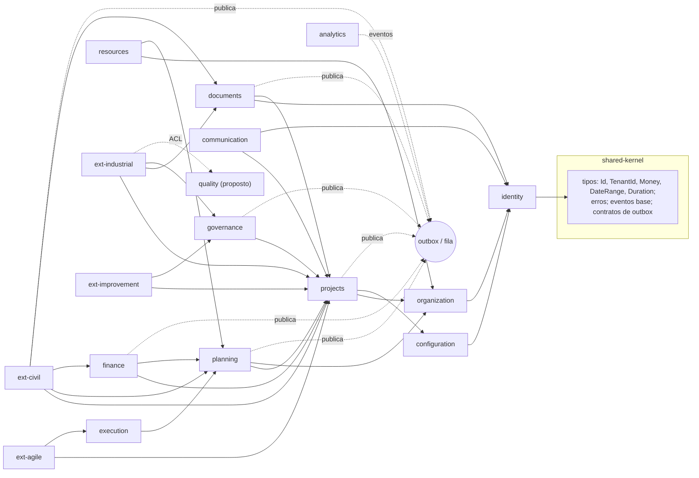

# Dependências entre módulos

**Status:** proposta. Nenhum diretório ou pacote foi criado.

## 1. Grafo de dependências permitidas

Uma seta A → B significa que **A pode chamar a interface pública de B**. Ciclos são proibidos.



Todo módulo depende implicitamente do `shared-kernel`. As setas para ele foram omitidas por clareza, exceto a de `identity`.

## 2. Matriz de dependências

Linha = consumidor; coluna = provedor.

- ● chamada síncrona à interface pública
- ○ só eventos
- vazio = proibido

| ↓ consome / provê → | IT | ORG | CFG | PRJ | PLN | EXE | FIN | RES | GOV | DOC | COM |
|---|---|---|---|---|---|---|---|---|---|---|---|
| organization | ● | | | | | | | | | | |
| configuration | ● | | | | | | | | | | |
| projects | ● | ● | ● | | | | | | | | |
| planning | ● | ● | | ● | | | | | | | |
| execution | ● | | | ● | ● | | | | | | |
| finance | ● | | | ● | ● | | | | ○ | | |
| resources | ● | ● | | | ● | | | | | | |
| governance | ● | | | ● | ○ | | ○ | | | | |
| documents | ● | | | ● | | | | | | | |
| communication | ● | | | ● | | | | | ○ | ○ | |
| analytics | ● | ○ | | ○ | ○ | ○ | ○ | ○ | ○ | ○ | |
| ext-industrial | ● | | | ● | | | | | ● | ● | |
| ext-civil | ● | | | ● | ● | | ● | | | ● | |
| ext-agile | ● | | | ● | | ● | | | | | |
| ext-improvement | ● | | | ● | | | | | ● | | |

**Observação 1 — `governance` ↔ `planning`/`finance`:** a mudança aprovada (DR-06) cria revisões. Para não haver ciclo, `governance` **publica** `ChangeApproved`, e `planning`/`finance` reagem criando as revisões em rascunho. A especificação diz que Governance depende só de Projects; essa solução preserva isso.

**Observação 2 — núcleo × extensões:** nenhum módulo do núcleo depende de extensão. As extensões se registram em **pontos de extensão** publicados pelo núcleo: abas, tipos de entregável, validadores de gate e campos tipados.

## 3. Estrutura interna de cada módulo (proposta)

```
<modulo>/
  domain/        entidades, objetos de valor, regras puras (sem I/O)
  application/   casos de uso, comandos, consultas, portas
  infra/         repositórios SQL, adaptadores de fila, storage
  api/           controladores HTTP / DTOs OpenAPI
  public/        o ÚNICO ponto importável por outros módulos (interfaces + tipos + eventos)
  tests/
```

**Regras verificáveis em CI**, com ferramenta a definir (p. ex. *dependency-cruiser* ou *eslint-plugin-boundaries*):

1. Outros módulos só importam `*/public`.
2. `domain/` não importa `infra/` nem frameworks.
3. Cada módulo acessa só o próprio *schema* do banco, com `GRANT` por papel de módulo quando viável.
4. Não há ciclos entre módulos.

## 4. Estrutura de repositório proposta (hipótese, a aprovar)

Os protótipos existentes **ficam onde estão**, intocados.

```
/                     (protótipos atuais preservados: index.html, js/, css/, projetos/, tests/)
/docs/architecture/   (esta documentação)
/platform/
  apps/web/           front-end (Next.js) — P-01
  apps/api/           monólito modular (NestJS ou equivalente) — P-01
  packages/shared-kernel/
  packages/modules/<contexto>/   (identity, organization, projects, planning, ...)
  packages/extensions/<setor>/   (industrial, civil, agile, improvement)
  db/migrations/      migrações versionadas e revisáveis
  tests/isolation/    testes de vazamento entre tenants (CA-1)
```

| Item | Evidência | Hipótese | Pendência |
|---|---|---|---|
| Monorepo no mesmo repositório | Repositório pequeno, sem stack de servidor (`current-state.md` §2) | Manter protótipos e plataforma juntos facilita usar os protótipos como referência | P-01: repositório separado ou pasta `/platform` |
| Domínio portado de `projetos/js/calc.js` | Funções puras com testes | A tradução para TypeScript mantém os testes como casos de referência | — |
