# Roadmap e plano de implementação

**Status:** proposta. **Nenhuma fase além da F0 foi iniciada.** O início da F1 depende da aprovação do responsável e das respostas às perguntas bloqueantes (§3).

## 1. Fases e gates

```mermaid
flowchart LR
  F0["F0 Diagnóstico\n(esta entrega)"] -->|Gate 1: arquitetura aprovada| F1["F1 Fundação"]
  F1 -->|Gate 2: testes de isolamento verdes| F2["F2 Núcleo mínimo"]
  F2 -->|Gate 3: fluxo ponta a ponta GEN-001| F3["F3 Controle"]
  F3 -->|Gate 4: reconciliação de custo e cronograma| F4["F4 Piloto industrial IND-001"]
  F4 -->|Gate 5: validação com usuário real| F5["F5 Piloto civil CIV-001"]
  F5 --> F6["F6 Expansão"]
```

Regra da especificação (§10): **não se libera fase só porque as telas existem.** Cada gate tem critérios verificáveis em `acceptance-criteria.md`.

| Fase | Entregas principais | Gate de saída | Depende de |
|---|---|---|---|
| **F0** | Os 9 documentos desta pasta; mapa de lacunas; perguntas bloqueantes; primeiro incremento | Aprovação escrita do responsável + respostas a P-01, P-03, P-04, P-09, P-12, P-13, P-14 | — |
| **F1** | Monorepo `/platform`, CI (lint, tipos, testes, fronteiras), PostgreSQL com migrações, tenant/planta/usuário/vínculo/papéis, cliente/fornecedor, auditoria *append-only*, outbox, RLS, **suite de isolamento** | CA-1 (parcial: leitura, escrita, listagem e exportação via API e SQL), auditoria encadeada verificável | F0 |
| **F2** | Projeto, template versionado (GEN-001), EAP, atividades, dependências, calendário, cronograma básico (sem CPM completo), documentos com revisões e aprovação | CA-2, CA-5, fluxo GEN-001 de ponta a ponta | F1 |
| **F3** | Baseline, CPM, riscos, mudanças com segregação, orçamento com revisões, custos (comprometido/incorrido/pago), EVM com método de medição, recursos, reuniões, notificações, relatórios; saúde PMBOK 8 como projeção | CA-3, CA-4, CA-7, CA-8 (cálculos); reconciliação de custos e cronograma com planilha de referência | F2 |
| **F4** | IND-001: nomeação → viabilidade → produto/processo → compra/fabricação → try-out → validação → PPAP → liberação; vínculo de características (depende de P-02) | Fluxo IND-001 executado com **um projeto real** e usuários reais (P-12) | F3 |
| **F5** | CIV-001: locais, orçamento de obra, contratos, diário, avanço, medições | CA-6, fluxo CIV-001 com caso real (P-11) | F3 (paralelizável com F4 se houver equipe) |
| **F6** | Dashboards, integrações (ERP, e-mail, storage), Improvement, Agile opcional, IA supervisionada, importador dos protótipos | Por item | F3+ |

## 2. Primeiro incremento vertical recomendado

### Incremento 1 — "Do login ao projeto criado de template versionado, isolado por empresa"

**Objetivo:** provar de ponta a ponta as três decisões de maior risco antes de investir em funcionalidades:

1. isolamento multiempresa (R-01);
2. template versionado com snapshot (R-07);
3. auditoria e eventos confiáveis (R-04).

Atravessa todas as camadas (web → API → domínio → banco → outbox) com o **mínimo** de cada uma.

| Camada | Escopo incluído | Fora do escopo |
|---|---|---|
| Infra/CI | Monorepo `/platform`, CI com lint, tipos, testes unitários e de integração com PostgreSQL efêmero, verificação de fronteiras | Deploy em produção, observabilidade completa |
| Banco | Migrações: `tenant`, `organization_unit`, `user_account`, `membership`, `role` (4 papéis fixos), `client`, `project_template`, `project_template_version`, `template_component`, `project`, `wbs_node`, `activity`, `audit_event`, `outbox_event`, `idempotency_key`. RLS em todas as tabelas de tenant | Dependências, calendário, finanças, documentos |
| Domínio | Regras DR-01, DR-02, DR-14, DR-15; máquina de estados do projeto até `aprovado` | Baseline, CPM, EVM |
| API (OpenAPI) | `POST /clients`, `GET /clients`, `GET /templates`, `POST /projects` (a partir de `template_version_id`, com *Idempotency-Key*), `GET /projects`, `GET /projects/{id}` com EAP e atividades, `GET /projects/{id}/audit` | Edição de atividades, exportações |
| Web | Login (OIDC; provedor de desenvolvimento local), lista de clientes, assistente de novo projeto (cliente + template + tailoring reaproveitado), visão da EAP somente leitura | Kanban, Gantt, painel |
| Template | **GEN-001 v1** como template de **sistema** (configuração, não dado fictício), derivado do modelo "Outro" e da estrutura PMBOK 8 já existentes | IND-001 e CIV-001 |
| Testes | Isolamento entre 2 tenants (API + SQL direto com RLS + listagem + exportação); CA-2 (nova versão do template não altera projeto existente; diff entre versões); idempotência da criação; auditoria encadeada | — |

**Por que este e não um fluxo industrial direto:** a especificação coloca o isolamento como primeiro gate (§10). Um piloto industrial construído sobre um tenant/template ainda não provado seria retrabalho caro.

**Tamanho relativo:** médio. Nenhuma funcionalidade nova visível ao usuário final além do "criar projeto", mas toda a fundação verificada.

**Os protótipos atuais continuam disponíveis e intocados** durante todo o incremento.

## 3. Perguntas bloqueantes

Respostas necessárias antes de alterar código estrutural. ★ = bloqueia o Incremento 1.

| ID | Pergunta | Recomendação do arquiteto | Bloqueia |
|---|---|---|---|
| P-01 ★ | Stack e localização do código: TypeScript + NestJS + Next.js + PostgreSQL 17 (referência §9) em `/platform` deste repositório, ou em repositório novo? Que camada de acesso a dados (SQL-first, como Kysely, ou ORM, como Prisma/Drizzle)? | TypeScript, NestJS, Next.js, PostgreSQL 17 e camada **SQL-first** (melhor controle de RLS e constraints), em `/platform` deste repositório | F1 |
| P-02 | O que fazer com o app de Qualidade (Core Tools)? (a) virar o contexto **Quality** da plataforma; (b) integrar só características e planos de controle; (c) manter fora do produto | (b) no curto prazo, para viabilizar `industrial_characteristic_link` no F4; (a) avaliado no F6 | F4 |
| P-03 ★ | "Cliente interno" (área da fábrica) deve virar **unidade organizacional**, com cliente externo opcional no projeto? | Sim (C-07) | F1 |
| P-04 ★ | Templates: só do sistema, só do tenant, ou ambos (tenant copia e versiona a partir do sistema)? | Ambos | F2 (o modelo de dados é decidido na F1) |
| P-05 | Calendário: dias úteis, turnos, feriados nacionais/estaduais/municipais, paradas coletivas? Duração em dias ou horas? | Minutos úteis por calendário; feriados nacionais pré-cadastrados, locais por planta | F2/F3 |
| P-06 | EVM: métodos de medição aceitos, curva de distribuição do VP, fórmula oficial da ENT | 0/100, 50/50, marcos ponderados, unidades e % físico medido; VP linear por padrão; ENT = ONT/IDC | F3 |
| P-07 | Integrações: qual ERP (TOTVS, SAP, outro), e-mail, armazenamento de arquivos? | Adiar para F6; F2 com object storage compatível com S3 | F6 |
| P-08 | Matriz de aprovação: quem aprova o quê, limites para exigir mudança, quando há segregação | Coletar com o usuário antes da F3 | F3 |
| P-09 ★ | Modelo de implantação: SaaS público multiempresa, ou primeiro só a sua empresa (com várias plantas)? Nuvem e região (LGPD)? Faturamento? | Arquitetura multiempresa desde a F1, mas **primeiro tenant = sua empresa**; faturamento fora do MVP | F1 |
| P-10 | Manter o PMBOK 8 (7 domínios, 5 áreas de foco, saúde por domínio) como linguagem do produto? A especificação não o cita | Sim, como projeção de Analytics e guia de UX, sem acoplar o domínio | F3 |
| P-11 | O setor civil faz parte do seu uso real ou é para outro público? Quem valida as regras de medição? | Confirmar antes de investir na F5 | F5 |
| P-12 ★ | Qual o primeiro caso real de teste e quem valida? | Um projeto de ferramental em andamento na sua empresa | Gate 3 |
| P-13 ★ | Provedor de identidade (Microsoft Entra ID, Google, outro)? MFA obrigatório para quem? Assinatura eletrônica simples ou ICP-Brasil? | OIDC genérico; Entra ID se a empresa usa Microsoft 365; MFA para administradores e aprovadores | F1 |
| P-14 ★ | Os dados lançados nos protótipos (navegador) são reais e precisam ser importados? | Se sim, importador no F6 a partir do backup JSON, com revisão manual de nomes → usuários | ADR-008 |
| P-15 | Os manuais AIAG/VDA e os CSRs são licenciados pela empresa? Quem fornece as tabelas oficiais? | Parametrizar, sem embutir conteúdo licenciado (DR-16) | F4 |

## 4. Conflitos identificados

| ID | Conflito | Entre | Proposta de resolução |
|---|---|---|---|
| K-01 | Sprints e pontos estão no núcleo do protótipo; a especificação os quer como extensão opcional | Protótipo × §1/§3 | Mover para `ext-agile`. O Kanban fica transversal (Execution) |
| K-02 | EVM com % subjetivo | Protótipo × §5 | Método de medição obrigatório para EVM oficial; % subjetivo só como indicador informal (C-16) |
| K-03 | Modelos não versionados e projeto sem referência à origem | Protótipo × §2.6/§6 | Motor de templates (ADR-005) |
| K-04 | PMBOK 8 como referencial central no protótipo; a especificação não o menciona | Pedido anterior do usuário × especificação | P-10 |
| K-05 | Construção civil como piloto, enquanto o contexto do usuário é metalúrgica | Especificação × histórico do usuário | P-11 |
| K-06 | O app Core Tools não tem lugar no mapa de contextos | Repositório × §3 | P-02 / L-01 |
| K-07 | Dados de exemplo carregados automaticamente | Protótipo × CA-9 | Seed só em ambiente de demonstração |
| K-08 | Pessoas referenciadas por nome | Protótipo × §4 | IDs + importador com revisão manual |
| K-09 | Governance "depende só de Projects", mas mudança aprovada precisa gerar revisões em Planning e Finance | Interna à especificação | Por eventos (`module-dependencies.md` §2, observação 1) |
| K-10 | Itens de consistência C-01 a C-17 | Interna à especificação | `data-model.md` §5 |

## 5. O que **não** foi feito nesta fase (conforme instruído)

- Nenhuma migração, tabela, dependência instalada ou módulo implementado.
- Nenhuma alteração nos protótipos (`/`, `projetos/`, `tests/`).
- Só foram criados os documentos em `docs/architecture/`.
